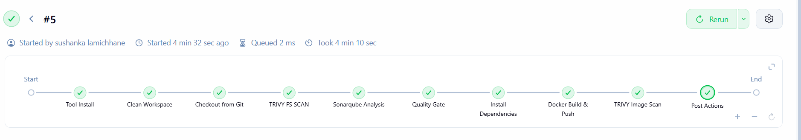
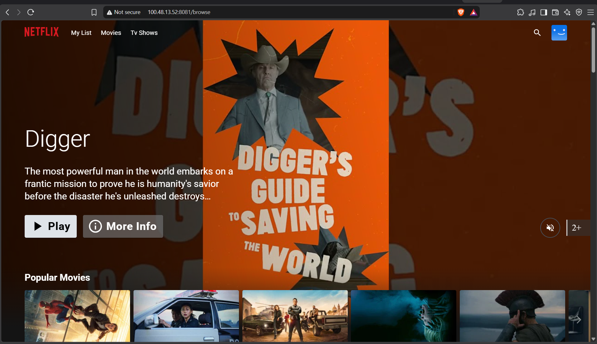

# DevSecOps: Netflix Clone CI/CD Pipeline (Jenkins + SonarQube + Trivy + Docker)

A hands-on DevSecOps project that builds and ships a **Netflix clone** through a fully automated
**Jenkins** CI/CD pipeline. The pipeline pulls the source from Git, runs security and code-quality
scans (**Trivy** + **SonarQube**), builds a **Docker** image, pushes it to Docker Hub, and emails
the build report with scan results attached.

> This README covers **Steps 1 → 10** of the workflow (up to *Docker Image Build & Push* and
> running the container). It is self-contained — anyone can follow it start to finish and reproduce
> the same result.
>
> Original reference project: [NotHarshhaa/DevOps-Project-09](https://github.com/NotHarshhaa/DevOps-Projects/tree/master/DevOps-Project-09)

---

## Table of Contents

- [Architecture / Flow](#architecture--flow)
- [Tech Stack](#tech-stack)
- [Prerequisites](#prerequisites)
- [Step 1 — Launch an Ubuntu 22.04 EC2 Instance](#step-1--launch-an-ubuntu-2204-ec2-instance)
- [Step 2 — Install Jenkins, Docker, Trivy & SonarQube](#step-2--install-jenkins-docker-trivy--sonarqube)
- [Step 3 — Create a TMDB API Key](#step-3--create-a-tmdb-api-key)
- [Step 4 — Install Prometheus, Grafana & Node Exporter](#step-4--install-prometheus-grafana--node-exporter)
- [Step 5 — Install the Prometheus Plugin & Integrate with Jenkins](#step-5--install-the-prometheus-plugin--integrate-with-jenkins)
- [Step 6 — Email Integration with Jenkins](#step-6--email-integration-with-jenkins)
- [Step 7 — Install Jenkins Plugins (JDK, SonarQube Scanner, NodeJS)](#step-7--install-jenkins-plugins-jdk-sonarqube-scanner-nodejs)
- [Step 8 — Create a Declarative Pipeline Project](#step-8--create-a-declarative-pipeline-project)
- [Step 9 — Install OWASP Dependency-Check (optional)](#step-9--install-owasp-dependency-check-optional)
- [Step 10 — Docker Image Build, Push & Run](#step-10--docker-image-build-push--run)
- [Full Jenkinsfile](#full-jenkinsfile)
- [Results / Screenshots](#results--screenshots)
- [Troubleshooting](#troubleshooting)
- [Credits](#credits)

---

## Architecture / Flow

```
Developer ──push──▶ GitHub (Netflix-clone)
                        │
                        ▼
               ┌──────────────────┐
               │     Jenkins      │
               │  (CI/CD server)  │
               └──────────────────┘
                        │
   ┌────────────────────┼─────────────────────────────┐
   ▼                    ▼                              ▼
Trivy FS Scan     SonarQube Analysis            npm install
                  + Quality Gate
                        │
                        ▼
              Docker Build ──▶ Docker Hub (sushanka001/netflix)
                        │
                        ▼
              Trivy Image Scan ──▶ trivyimage.txt
                        │
                        ▼
          Email report (trivyfs.txt + trivyimage.txt attached)
                        │
                        ▼
              docker run ──▶ Netflix clone on :8081
```

---

## Tech Stack

| Tool | Purpose |
|------|---------|
| **Ubuntu 22.04 (EC2 t2.large)** | Host server for Jenkins / Docker / SonarQube |
| **Jenkins** | CI/CD orchestration (declarative pipeline) |
| **Docker** | Build & run the Netflix clone container |
| **SonarQube** | Static code analysis + quality gate |
| **Trivy** | Filesystem & container image vulnerability scanning |
| **Node.js 18 / JDK 17** | Build tooling for the React app |
| **TMDB API** | Movie metadata & images for the clone |
| **Prometheus / Grafana** | Monitoring (optional, Steps 4–5) |

---

## Prerequisites

- An **AWS account** (free-tier eligible, but this uses a `t2.large` which is **not** free-tier).
- A **Docker Hub account** (for pushing the image).
- A **TMDB account** (for the API key).
- A **Gmail account** with an **App Password** (for email notifications).
- Basic familiarity with Linux and the AWS console.

---

## Step 1 — Launch an Ubuntu 22.04 EC2 Instance

1. In the AWS console, launch an EC2 instance:
   - **AMI:** Ubuntu Server 22.04 LTS
   - **Instance type:** `t2.large` (2 vCPU / 8 GB RAM — Jenkins + SonarQube need the memory)
   - **Key pair:** create new or use an existing one
   - **Storage:** 25–30 GB
2. In the **Security Group**, open the ports you need. For learning you can allow all, but the
   minimum recommended inbound rules are:

| Port | Service |
|------|---------|
| 22   | SSH |
| 8080 | Jenkins |
| 9000 | SonarQube |
| 8081 | Netflix app (container) |
| 9090 | Prometheus (optional) |
| 3000 | Grafana (optional) |
| 9100 | Node Exporter (optional) |

3. Connect via SSH:

```bash
ssh -i your-key.pem ubuntu@<EC2-PUBLIC-IP>
```

---

## Step 2 — Install Jenkins, Docker, Trivy & SonarQube

### 2A. Install Jenkins (with JDK 17)

```bash
vi jenkins.sh
```

Paste:

```bash
#!/bin/bash
sudo apt update -y
wget -O - https://packages.adoptium.net/artifactory/api/gpg/key/public | sudo tee /etc/apt/keyrings/adoptium.asc
echo "deb [signed-by=/etc/apt/keyrings/adoptium.asc] https://packages.adoptium.net/artifactory/deb $(awk -F= '/^VERSION_CODENAME/{print$2}' /etc/os-release) main" | sudo tee /etc/apt/sources.list.d/adoptium.list
sudo apt update -y
sudo apt install temurin-17-jdk -y
/usr/bin/java --version
curl -fsSL https://pkg.jenkins.io/debian-stable/jenkins.io-2023.key | sudo tee /usr/share/keyrings/jenkins-keyring.asc > /dev/null
echo "deb [signed-by=/usr/share/keyrings/jenkins-keyring.asc] https://pkg.jenkins.io/debian-stable binary/" | sudo tee /etc/apt/sources.list.d/jenkins.list > /dev/null
sudo apt-get update -y
sudo apt-get install jenkins -y
sudo systemctl start jenkins
sudo systemctl enable jenkins
sudo systemctl status jenkins
```

Run it:

```bash
sudo chmod +x jenkins.sh
./jenkins.sh
```

Open Jenkins at `http://<EC2-PUBLIC-IP>:8080` and unlock it with:

```bash
sudo cat /var/lib/jenkins/secrets/initialAdminPassword
```

Install **Suggested Plugins** and create your admin user.

### 2B. Install Docker

```bash
sudo apt-get update
sudo apt-get install docker.io -y
sudo usermod -aG docker ubuntu
sudo usermod -aG docker jenkins       # let Jenkins run docker
newgrp docker
sudo chmod 777 /var/run/docker.sock
```

> After adding `jenkins` to the docker group, restart Jenkins:
> `sudo systemctl restart jenkins`

Create a **SonarQube** container:

```bash
docker run -d --name sonar -p 9000:9000 sonarqube:lts-community
```

Access SonarQube at `http://<EC2-PUBLIC-IP>:9000` (default login `admin` / `admin`).

### 2C. Install Trivy

```bash
vi trivy.sh
```

Paste:

```bash
sudo apt-get install wget apt-transport-https gnupg lsb-release -y
wget -qO - https://aquasecurity.github.io/trivy-repo/deb/public.key | gpg --dearmor | sudo tee /usr/share/keyrings/trivy.gpg > /dev/null
echo "deb [signed-by=/usr/share/keyrings/trivy.gpg] https://aquasecurity.github.io/trivy-repo/deb $(lsb_release -sc) main" | sudo tee -a /etc/apt/sources.list.d/trivy.list
sudo apt-get update
sudo apt-get install trivy -y
```

Run it:

```bash
sudo chmod +x trivy.sh
./trivy.sh
```

---

## Step 3 — Create a TMDB API Key

1. Go to [themoviedb.org](https://www.themoviedb.org/) and create an account.
2. Click your **profile → Settings → API**.
3. Click **Create → Developer**, accept the terms, fill in the basic details, and submit.
4. Copy the **API Key (v3 auth)** — you'll pass it to the Docker build as `TMDB_V3_API_KEY`.

> The API key is injected at build time via `--build-arg TMDB_V3_API_KEY=...` (see Step 10).

---

## Step 4 — Install Prometheus, Grafana & Node Exporter

> **Optional (monitoring).** You can skip this if you only want the CI/CD pipeline. It is included
> because the original project uses it. Run these on a **separate** monitoring server (or the same
> box for learning).

### Prometheus

```bash
sudo useradd --system --no-create-home --shell /bin/false prometheus
wget https://github.com/prometheus/prometheus/releases/download/v2.47.1/prometheus-2.47.1.linux-amd64.tar.gz
tar -xvf prometheus-2.47.1.linux-amd64.tar.gz
sudo mkdir -p /data /etc/prometheus
cd prometheus-2.47.1.linux-amd64/
sudo mv prometheus promtool /usr/local/bin/
sudo mv consoles/ console_libraries/ /etc/prometheus/
sudo mv prometheus.yml /etc/prometheus/prometheus.yml
sudo chown -R prometheus:prometheus /etc/prometheus/ /data/
```

Create the systemd unit `sudo vim /etc/systemd/system/prometheus.service`:

```ini
[Unit]
Description=Prometheus
Wants=network-online.target
After=network-online.target
StartLimitIntervalSec=500
StartLimitBurst=5

[Service]
User=prometheus
Group=prometheus
Type=simple
Restart=on-failure
RestartSec=5s
ExecStart=/usr/local/bin/prometheus \
  --config.file=/etc/prometheus/prometheus.yml \
  --storage.tsdb.path=/data \
  --web.console.templates=/etc/prometheus/consoles \
  --web.console.libraries=/etc/prometheus/console_libraries \
  --web.listen-address=0.0.0.0:9090 \
  --web.enable-lifecycle

[Install]
WantedBy=multi-user.target
```

```bash
sudo systemctl enable prometheus
sudo systemctl start prometheus
```

Access Prometheus at `http://<IP>:9090`.

### Node Exporter

```bash
sudo useradd --system --no-create-home --shell /bin/false node_exporter
wget https://github.com/prometheus/node_exporter/releases/download/v1.6.1/node_exporter-1.6.1.linux-amd64.tar.gz
tar -xvf node_exporter-1.6.1.linux-amd64.tar.gz
sudo mv node_exporter-1.6.1.linux-amd64/node_exporter /usr/local/bin/
rm -rf node_exporter*
```

Create `sudo vim /etc/systemd/system/node_exporter.service`:

```ini
[Unit]
Description=Node Exporter
Wants=network-online.target
After=network-online.target
StartLimitIntervalSec=500
StartLimitBurst=5

[Service]
User=node_exporter
Group=node_exporter
Type=simple
Restart=on-failure
RestartSec=5s
ExecStart=/usr/local/bin/node_exporter --collector.logind

[Install]
WantedBy=multi-user.target
```

```bash
sudo systemctl enable node_exporter
sudo systemctl start node_exporter
```

Add a scrape target to `/etc/prometheus/prometheus.yml`:

```yaml
  - job_name: node_export
    static_configs:
      - targets: ["localhost:9100"]
```

Reload Prometheus:

```bash
promtool check config /etc/prometheus/prometheus.yml
curl -X POST http://localhost:9090/-/reload
```

### Grafana

```bash
sudo apt-get install -y apt-transport-https software-properties-common
wget -q -O - https://packages.grafana.com/gpg.key | sudo apt-key add -
echo "deb https://packages.grafana.com/oss/deb stable main" | sudo tee -a /etc/apt/sources.list.d/grafana.list
sudo apt-get update
sudo apt-get -y install grafana
sudo systemctl enable grafana-server
sudo systemctl start grafana-server
```

Access Grafana at `http://<IP>:3000` (login `admin` / `admin`). Add **Prometheus** as a data source
(`http://localhost:9090`) and import dashboard **ID 1860** for node metrics.

---

## Step 5 — Install the Prometheus Plugin & Integrate with Jenkins

1. In Jenkins: **Manage Jenkins → Plugins → Available**, search **Prometheus metrics** and install.
2. Jenkins now exposes metrics at `/prometheus`.
3. Add a Jenkins scrape job to `/etc/prometheus/prometheus.yml`:

```yaml
  - job_name: 'jenkins'
    metrics_path: '/prometheus'
    static_configs:
      - targets: ['<jenkins-ip>:8080']
```

4. Reload Prometheus:

```bash
promtool check config /etc/prometheus/prometheus.yml
curl -X POST http://localhost:9090/-/reload
```

5. In Grafana, import dashboard **ID 9964** to visualize Jenkins metrics.

---

## Step 6 — Email Integration with Jenkins

1. Install the **Email Extension Plugin** in Jenkins.
2. In your Google Account, enable **2-Step Verification**, then create an **App Password**
   (Security → App passwords). Copy the 16-character password.
3. **Manage Jenkins → Credentials** → add *Username with password*:
   - Username: your Gmail address
   - Password: the generated **App Password**
4. **Manage Jenkins → System**:
   - **E-mail Notification**: SMTP server `smtp.gmail.com`, use SSL, port `465`, provide credentials.
   - **Extended E-mail Notification**: SMTP `smtp.gmail.com`, port `465`, SSL, select the credentials.
5. The `post { always { emailext ... } }` block in the Jenkinsfile sends the result with
   `trivyfs.txt` and `trivyimage.txt` attached.

---

## Step 7 — Install Jenkins Plugins (JDK, SonarQube Scanner, NodeJS)

### 7A. Install plugins
**Manage Jenkins → Plugins → Available**, install (no restart needed):
- **Eclipse Temurin Installer**
- **SonarQube Scanner**
- **NodeJS**

### 7B. Configure tools
**Manage Jenkins → Tools**:
- **JDK installations** → add, name it **`jdk17`**, install from adoptium, version 17.
- **NodeJS installations** → add, name it **`node18`**, version 18.x.  *(Node 18 — not 16.)*
- **SonarQube Scanner installations** → add, name it **`sonar-server`**.

> ⚠️ The tool names must match the Jenkinsfile exactly: `jdk17`, `node18`, `sonar-server`.

### 7C. Create the job
**New Item → Netflix → Pipeline → OK.**

---

## Step 8 — Create a Declarative Pipeline Project

### Configure the SonarQube server in Jenkins

1. In **SonarQube** (`:9000`): **Administration → Security → Users → Tokens**, generate a token and copy it.
2. In **Jenkins → Manage Jenkins → Credentials**, add a **Secret text** credential with the token,
   ID **`Sonar-token`**.
3. **Manage Jenkins → System → SonarQube servers**: add a server named **`sonar-server`** with URL
   `http://<EC2-IP>:9000` and select the `Sonar-token` credential.
4. In SonarQube, add a **webhook** (**Administration → Configuration → Webhooks → Create**):

```
http://<jenkins-ip>:8080/sonarqube-webhook/
```

### Add the pipeline script
Paste the [full Jenkinsfile](#full-jenkinsfile) below into the pipeline definition (or point the job
at **Pipeline script from SCM** using the `Jenkinsfile` in this repo), then **Build Now**.

You should see each stage turn green in the **Stage View** and a quality report appear in SonarQube
under **Projects → Netflix**.

---

## Step 9 — Install OWASP Dependency-Check (optional)

> Optional. The reference project adds an OWASP Dependency-Check stage. The pipeline in this repo
> keeps Trivy as the primary scanner, but you can add OWASP too.

1. **Manage Jenkins → Plugins → Available**, install **OWASP Dependency-Check** (no restart).
2. **Manage Jenkins → Tools → Dependency-Check installations** → add, name it **`DP-Check`**.
3. Add this stage to the pipeline if you want OWASP scanning:

```groovy
stage('OWASP FS Scan') {
    steps {
        dependencyCheck additionalArguments: '--scan ./ --disableYarnAudit --disableNodeAudit', odcInstallation: 'DP-Check'
        dependencyCheckPublisher pattern: '**/dependency-check-report.xml'
    }
}
```

---

## Step 10 — Docker Image Build, Push & Run

### Configure Docker in Jenkins
1. **Manage Jenkins → Plugins → Available**, install: **Docker**, **Docker Commons**,
   **Docker Pipeline**, **Docker API**, **docker-build-step**.
2. **Manage Jenkins → Tools → Docker installations** → add, name it **`docker`**, install automatically.
3. **Manage Jenkins → Credentials** → add *Username with password* for Docker Hub, ID **`docker`**.

### Build & push stage
This is already included in the Jenkinsfile:

```groovy
stage('Docker Build & Push') {
    steps {
        script {
            withDockerRegistry(credentialsId: 'docker', toolName: 'docker') {
                sh "docker build --build-arg TMDB_V3_API_KEY=<your-tmdb-key> -t netflix ."
                sh "docker tag netflix sushanka001/netflix:latest"
                sh "docker push sushanka001/netflix:latest"
            }
        }
    }
}
stage('Trivy Image Scan') {
    steps {
        sh "trivy image sushanka001/netflix:latest > trivyimage.txt"
    }
}
```

> Replace `sushanka001` with **your** Docker Hub username and `<your-tmdb-key>` with your TMDB key.

### Run the container
After the push succeeds, run the image to verify the app:

```bash
docker run -d --name netflix -p 8081:80 sushanka001/netflix:latest
```

Open the app at:

```
http://<EC2-PUBLIC-IP>:8081
```

You should see the Netflix clone homepage with movies pulled from TMDB. 🎬

> **This is where this guide ends (Step 10).** The original project continues with Kubernetes
> deployment and full monitoring (Steps 11–14) — not covered here.

---

## Full Jenkinsfile

> Note: the NodeJS tool is **`node18`** (Node 18), and the SonarQube scanner tool is **`sonar-server`**.
> See [`Jenkinsfile`](./Jenkinsfile) in this repo.

```groovy
pipeline {
    agent any
    tools {
        jdk 'jdk17'
        nodejs 'node18'
    }
    environment {
        SCANNER_HOME = tool 'sonar-server'
    }
    stages {
        stage('Clean Workspace') {
            steps {
                cleanWs()
            }
        }
        stage('Checkout from Git') {
            steps {
                git branch: 'main', url: 'https://github.com/SUSHANK001-ops/Netflix-clone.git'
            }
        }
        stage('Trivy FS Scan') {
            steps {
                sh "trivy fs . > trivyfs.txt"
            }
        }
        stage('SonarQube Analysis') {
            steps {
                withSonarQubeEnv('sonar-server') {
                    sh ''' $SCANNER_HOME/bin/sonar-scanner -Dsonar.projectName=Netflix \
                    -Dsonar.projectKey=Netflix '''
                }
            }
        }
        stage('Quality Gate') {
            steps {
                script {
                    waitForQualityGate abortPipeline: false, credentialsId: 'Sonar-token'
                }
            }
        }
        stage('Install Dependencies') {
            steps {
                sh "npm install"
            }
        }
        stage('Docker Build & Push') {
            steps {
                script {
                    withDockerRegistry(credentialsId: 'docker', toolName: 'docker') {
                        sh "docker build --build-arg TMDB_V3_API_KEY=a1b2c3d4e5f6g7h8i9j0k1l2m3n4o5p6 -t netflix ."
                        sh "docker tag netflix sushanka001/netflix:latest"
                        sh "docker push sushanka001/netflix:latest"
                    }
                }
            }
        }
        stage('Trivy Image Scan') {
            steps {
                sh "trivy image sushanka001/netflix:latest > trivyimage.txt"
            }
        }
    }
    post {
        always {
            emailext attachLog: true,
                subject: "'${currentBuild.result}'",
                body: "Project: ${env.JOB_NAME}<br/>" +
                    "Build Number: ${env.BUILD_NUMBER}<br/>" +
                    "URL: ${env.BUILD_URL}<br/>",
                to: 'sushanklamichhane12@gmail.com',
                attachmentsPattern: 'trivyfs.txt,trivyimage.txt'
        }
    }
}
```

---

## Results / Screenshots

### Jenkins pipeline — all stages passing
Build #5 running green through Clean Workspace → Checkout → Trivy FS Scan → SonarQube Analysis →
Quality Gate → Install Dependencies → Docker Build & Push → Trivy Image Scan → Post Actions.



### Netflix clone running — browse page
The deployed container served at `:8081`, pulling movie data and artwork from the TMDB API.



### Netflix clone running — playback


---

## Troubleshooting

| Issue | Fix |
|-------|-----|
| Jenkins can't run `docker` (`permission denied`) | `sudo usermod -aG docker jenkins && sudo systemctl restart jenkins` |
| `docker: command not found` in pipeline | Ensure the **Docker** tool is named `docker` in *Manage Jenkins → Tools* |
| SonarQube container keeps restarting | `t2.large` needed; also raise `vm.max_map_count`: `sudo sysctl -w vm.max_map_count=262144` |
| Quality Gate hangs forever | Confirm the SonarQube **webhook** points to `http://<jenkins-ip>:8080/sonarqube-webhook/` |
| TMDB images don't load in the app | Rebuild with a **valid** `TMDB_V3_API_KEY` build-arg |
| Email not sent | Use a Gmail **App Password**, SMTP `smtp.gmail.com`, port `465`, SSL enabled |
| Tool name errors (`No tool named ...`) | Names must match: `jdk17`, `node18`, `sonar-server`, `docker` |

---

## Credits

- Reference project: **[NotHarshhaa — DevOps-Project-09](https://github.com/NotHarshhaa/DevOps-Projects/tree/master/DevOps-Project-09)**
- Netflix clone source used in the pipeline: `https://github.com/SUSHANK001-ops/Netflix-clone`

---

*Implemented by **Sushank Lamichhane** — covering Steps 1–10 of the DevSecOps Netflix CI/CD workflow.*
